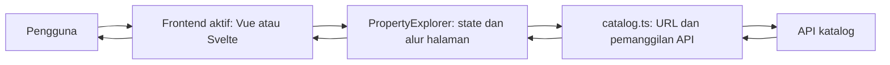

# Cara Kerja Vue dan Svelte pada Prototipe Airbnb

Dokumen ini menjelaskan bagaimana Vue dan Svelte membangun antarmuka prototipe katalog properti bergaya Airbnb, lalu menghubungkan konsep framework dengan fitur yang benar-benar tersedia. Penjelasan mengikuti source code frontend dan API saat ini. Prototipe ini bukan implementasi seluruh layanan Airbnb.

## 1. Gambaran sistem

Vue dan Svelte menangani komponen antarmuka, state tampilan, input pengguna, serta permintaan data. Keduanya menggunakan fungsi katalog dan API yang setara. API yang menangani pencarian, filter, pengurutan, dan pagination; frontend mengirim parameter lalu menampilkan responsnya.



Alur sederhananya:

```text
Browser memuat aplikasi
  -> framework memasang komponen utama ke halaman
  -> PropertyExplorer membaca URL dan menyiapkan state awal
  -> frontend meminta opsi filter dan data properti ke API
  -> respons disimpan ke state
  -> framework memperbarui tampilan yang bergantung pada state
  -> interaksi pengguna mengubah state atau memulai permintaan berikutnya
```

## 2. Cara kerja framework dalam implementasi ini

| Konsep | Vue | Svelte | Kaitannya dengan prototipe |
| --- | --- | --- | --- |
| Bentuk file komponen | `.vue`, berisi `<script setup>` dan `<template>` | `.svelte`, berisi `<script>` dan markup | Memisahkan UI menjadi `PropertyExplorer`, `SearchFilters`, `PropertyGrid`, `PropertyCard`, dan `PropertyDetail` |
| State reaktif | `shallowRef` untuk data katalog, `reactive` untuk draft form | `$state.raw` untuk data katalog, `$state` untuk nilai form dan flag | Menyimpan filter, daftar properti, halaman, wishlist, loading, dan error |
| Nilai turunan | `computed(...)` | `$derived(...)` | Membuat label hasil dan pesan error dari state yang sudah ada |
| Input form | `v-model` | `bind:value` dan `bind:group` | Mengubah draft filter ketika pengguna mengetik atau memilih opsi |
| Komunikasi komponen | Props turun, event `emit` naik | Props turun, callback function naik | Form mengirim filter ke parent; kartu meminta parent membuka detail atau mengganti wishlist |
| Percabangan dan daftar | `v-if` dan `v-for` dengan `:key` | `{#if}` dan keyed `{#each}` | Memilih tampilan katalog/detail/status dan membuat kartu dari data API |
| Siklus hidup dan browser | `onMounted` dan `onUnmounted` | `onMount` dan `<svelte:window>` | Memulai pemuatan awal serta merespons tombol Back/Forward browser |

### 2.1 Vue

Vue melacak penggunaan state reaktif saat komponen ditampilkan. Ketika nilai reaktif berubah, Vue menjadwalkan pembaruan tampilan yang bergantung padanya. Pada prototipe, objek respons API disimpan dalam `shallowRef`; karena itu array atau objek katalog diganti dengan assignment baru saat respons datang. `computed` menghasilkan nilai turunan seperti label jumlah properti.

Contoh dari `PropertyExplorer.vue`:

```ts
const properties = shallowRef<PropertyListItem[]>([]);
const pagination = shallowRef<PaginationMeta | null>(null);
const resultLabel = computed(
  () => `${pagination.value?.total ?? 0} properti ditemukan`
);

properties.value = response.data;
pagination.value = response.meta;
```

Artinya, saat data halaman pertama ditetapkan, template yang memakai daftar dan pagination akan menampilkan hasil baru. `.value` dipakai di script untuk membaca atau mengganti isi `shallowRef`; template Vue membukanya secara otomatis.

### 2.2 Svelte

Svelte mengompilasi file komponen `.svelte` menjadi modul JavaScript. Pada Svelte 5, runes seperti `$state`, `$state.raw`, `$derived`, dan `$props` menandai state, nilai turunan, serta props komponen. Compiler menggunakan penanda tersebut untuk menentukan hubungan antara perubahan data dan bagian tampilan yang perlu diperbarui.

Contoh dari `PropertyExplorer.svelte`:

```ts
let properties: PropertyListItem[] = $state.raw([]);
let pagination: PaginationMeta | null = $state.raw(null);
let resultLabel = $derived(
  `${pagination?.total ?? 0} properti ditemukan`
);

properties = response.data;
pagination = response.meta;
```

`$state.raw` dipakai untuk data katalog yang diganti sebagai satu nilai, bukan dimutasi jauh di dalam objek. `$derived` membentuk label dari pagination. Svelte tetap berjalan bersama runtime; istilah “compiler” menjelaskan bagaimana komponen dikompilasi, bukan berarti tidak ada runtime sama sekali.

## 3. Hubungan mekanisme framework dengan fitur

| Fitur prototipe | Mekanisme Vue | Mekanisme Svelte | Hasil yang dilihat pengguna |
| --- | --- | --- | --- |
| Membuka katalog | `onMounted`, `shallowRef`, `computed`, conditional template | `onMount`, `$state.raw`, `$derived`, `{#if}` | Katalog memuat opsi filter dan kartu properti; loading, error, atau empty state tampil sesuai kondisi |
| Mencari berdasarkan teks/lokasi | `v-model` pada draft form, `emit("search", ...)` | `bind:value`, callback `search(...)` | Pengguna mengisi kata kunci atau memilih lokasi lalu menekan tombol cari |
| Filter dan sorting | `v-model` untuk tipe, harga, kapasitas, kamar, amenitas, dan urutan | `bind:value` / `bind:group` pada field yang sama | Form mengirim kumpulan filter; hasil baru diminta setelah submit |
| Daftar kartu properti | `v-for` dengan `:key="property.id"` | keyed `{#each properties as property (property.id)}` | Kartu menampilkan foto, tipe, rating, lokasi, kapasitas, dan harga |
| Memuat hasil berikutnya | Parent mengambil halaman selanjutnya lalu menggabungkan array | Parent mengambil halaman selanjutnya lalu membuat array gabungan | Kartu tambahan muncul setelah tombol “Muat lainnya” dipilih |
| Detail properti | Event `open` diteruskan ke `openProperty(slug)` | Callback `openProperty(slug)` diteruskan ke kartu | URL menjadi `/properties/<slug>` dan panel detail dimuat dari API |
| Kembali ke katalog | `popstate` dikelola dengan listener lifecycle | `onpopstate` ditangani melalui `<svelte:window>` | Tombol Back/Forward memulihkan tampilan katalog/detail dan filter dari URL |
| Wishlist | `Map<string, boolean>` baru ditetapkan ke `shallowRef` | `Record<string, boolean>` baru ditetapkan ke `$state.raw` | Ikon dan label tombol berubah tanpa permintaan mutasi ke API |
| Status permintaan | `v-if`/`v-else-if` memilih loading, error, atau konten | `{#if}`/`{:else if}` memilih loading, error, atau konten | Pengguna mendapat umpan balik saat daftar atau detail sedang dimuat/gagal |

## 4. Alur tiap fitur

### 4.1 Memuat katalog pertama kali

Vue menjalankan inisialisasi dari `onMounted`; Svelte menjalankannya dari `onMount`. Keduanya mengecek apakah URL berisi slug detail. Jika tidak, filter dipulihkan dari query URL, lalu opsi dan halaman pertama diminta secara paralel.

```text
SAAT komponen utama dipasang:
    JIKA URL adalah /properties/<slug>:
        minta detail properti
    SELAIN ITU:
        baca filter dari query URL
        secara paralel:
            minta lokasi, tipe properti, dan amenitas
            minta halaman pertama properti

    saat permintaan selesai:
        simpan respons ke state
        render opsi filter, kartu, atau status yang sesuai
END
```

Fungsi `fetchCatalogOptions`, `fetchPropertyPage`, dan `fetchPropertyDetail` berada pada masing-masing `catalog.ts`. Kedua frontend mengirim permintaan ke kontrak API katalog yang sama.

### 4.2 Search, filter, dan sorting

`SearchFilters` menyimpan draft sementara agar pengguna bisa mengubah beberapa field sebelum menjalankan pencarian. Di Vue, nilai field terhubung ke draft dengan `v-model`; di Svelte, dengan `bind:value` atau `bind:group`. Submit mengirim salinan draft ke parent. Parent memperbarui query URL dan meminta ulang halaman pertama.

```text
SAAT pengguna mengubah field:
    perbarui draft lokal pada SearchFilters

SAAT pengguna submit:
    cegah reload form browser
    kirim salinan filter ke PropertyExplorer
    simpan filter aktif
    tulis filter ke query URL
    hapus tampilan detail jika sedang terbuka
    minta halaman 1 ke API dengan filter aktif
    ganti daftar lama dengan hasil baru
END
```

Frontend tidak menyaring atau mengurutkan seluruh dataset secara lokal. Ia meneruskan parameter pencarian/filter/sort ke API, lalu menampilkan hasil API.

### 4.3 Pagination dan “Muat lainnya”

Frontend meminta enam properti per halaman. Untuk pencarian baru, daftar lama diganti dan nomor halaman dimulai dari satu. Untuk “Muat lainnya”, frontend meminta halaman setelah halaman aktif dan menambahkan respons ke akhir daftar. Tombol tampil selama metadata pagination menyatakan masih ada hasil.

```text
SAAT pengguna memilih "Muat lainnya":
    nextPage = halaman aktif + 1
    response = minta halaman nextPage ke API
    jika response masih untuk permintaan terbaru:
        gabungkan response.data ke daftar yang tampil
        simpan response.meta
END
```

Kedua implementasi juga memakai nomor permintaan untuk mengabaikan respons lama jika pengguna memulai permintaan lain sebelum permintaan sebelumnya selesai.

### 4.4 Membuka detail dan navigasi browser

Klik foto atau judul kartu meneruskan slug ke `PropertyExplorer`. Parent memperbarui browser history, menampilkan state loading detail, lalu meminta detail ke API. Navigasi Back/Forward ditangani melalui `popstate`: jika URL menunjuk detail, detail dimuat; jika URL kembali ke katalog, filter dibaca dari query dan daftar dimuat ulang.

```text
SAAT pengguna membuka kartu:
    simpan URL katalog saat ini dalam history state
    ubah URL menjadi /properties/<slug>
    tampilkan status loading detail
    minta detail berdasarkan slug
    tampilkan detail atau pesan error

SAAT browser memicu popstate:
    jika URL memiliki slug:
        muat detail tanpa menambah history entry baru
    selain itu:
        pulihkan filter dari query URL
        muat halaman pertama katalog
END
```

Perbedaan implementasi: Vue mendaftarkan dan melepas listener `popstate` secara manual saat mount/unmount. Svelte menggunakan elemen khusus `<svelte:window onpopstate={...}>`.

### 4.5 Wishlist

Kartu menerima nilai `wishlisted` sebagai props. Saat tombol dipilih, Vue mengirim event `toggleWishlist`, sedangkan Svelte memanggil callback `toggleWishlist`. Parent membuat struktur state baru agar perubahan terlihat oleh framework. Respons katalog memberi nilai awal wishlist.

```text
SAAT tombol wishlist dipilih:
    baca nilai wishlist saat ini untuk propertyId
    balik nilai true/false
    simpan state baru
    render ulang status ikon, aria-label, dan aria-pressed
END
```

Wishlist ini hanya state frontend selama sesi aplikasi. Prototipe belum menyimpan perubahan ke database atau akun pengguna.

## 5. Contoh pola komunikasi komponen

Alur parent-child pada kartu properti menggambarkan perbedaan sintaks utama.

### Vue: props turun, event naik

```vue
<PropertyCard
  :property="property"
  :wishlisted="wishlistStates.get(property.id) ?? false"
  @open="openProperty"
  @toggle-wishlist="toggleWishlist"
/>
```

Kartu mendeklarasikan `defineProps` dan `defineEmits`, lalu mengirim event ketika pengguna membuka detail atau mengubah wishlist.

### Svelte: props turun, callback naik

```svelte
<PropertyCard
  {property}
  wishlisted={wishlistStates[property.id] ?? false}
  openProperty={openProperty}
  toggleWishlist={toggleWishlist}
/>
```

Kartu menerima fungsi tersebut melalui `$props()` dan memanggilnya saat pengguna berinteraksi. Dalam kedua pendekatan, state katalog tetap dikelola oleh parent `PropertyExplorer`.

## 6. Batas peran dan kesetaraan implementasi

- Vue dan Svelte mengelola cara state antarmuka berubah dan cara komponen merendernya.
- `catalog.ts` mengubah filter menjadi query, membaca URL, memanggil API, dan menyiapkan formatter.
- API memproses search, filter, sort, pagination, serta data detail.
- Kedua frontend ditujukan memiliki perilaku yang sepadan untuk dataset, fitur, URL, dan tampilan yang diuji. Perbedaan sintaks atau jumlah baris sendiri tidak membuktikan framework mana yang lebih cepat.
- Prototipe hanya mencakup eksplorasi katalog: tidak mencakup login, booking, pembayaran, chat, peta realtime, atau sinkronisasi wishlist akun.

## 7. Lokasi implementasi

| Area | Vue | Svelte |
| --- | --- | --- |
| Orkestrasi halaman | [`PropertyExplorer.vue`](../apps/airbnb-vue-app/src/components/PropertyExplorer.vue) | [`PropertyExplorer.svelte`](../apps/airbnb-svelte-app/src/components/PropertyExplorer.svelte) |
| Form pencarian/filter | [`SearchFilters.vue`](../apps/airbnb-vue-app/src/components/SearchFilters.vue) | [`SearchFilters.svelte`](../apps/airbnb-svelte-app/src/components/SearchFilters.svelte) |
| Grid dan kartu | [`PropertyGrid.vue`](../apps/airbnb-vue-app/src/components/PropertyGrid.vue), [`PropertyCard.vue`](../apps/airbnb-vue-app/src/components/PropertyCard.vue) | [`PropertyGrid.svelte`](../apps/airbnb-svelte-app/src/components/PropertyGrid.svelte), [`PropertyCard.svelte`](../apps/airbnb-svelte-app/src/components/PropertyCard.svelte) |
| API, filter, URL | [`catalog.ts`](../apps/airbnb-vue-app/src/catalog.ts) | [`catalog.ts`](../apps/airbnb-svelte-app/src/catalog.ts) |
| Breakdown fitur dan pseudocode | [`07-feature-breakdown-pseudocode.md`](07-feature-breakdown-pseudocode.md) | Sama |
| Breakdown UI/UX | [`08-ui-ux-breakdown.md`](08-ui-ux-breakdown.md) | Sama |

## 8. Referensi konsep framework

- Vue, [Reactivity Fundamentals](https://vuejs.org/guide/essentials/reactivity-fundamentals.html), [Components Basics](https://vuejs.org/guide/essentials/component-basics.html), dan [Single-File Components](https://vuejs.org/guide/scaling-up/sfc.html).
- Svelte, [What are runes?](https://svelte.dev/docs/svelte/what-are-runes), [`$state`](https://svelte.dev/docs/svelte/%24state), [`$derived`](https://svelte.dev/docs/svelte/%24derived), [`.svelte` files](https://svelte.dev/docs/svelte/svelte-files), dan [component props](https://svelte.dev/docs/svelte/%24props).

Referensi framework menjelaskan konsep umum. Rincian alur fitur di atas merujuk pada source code prototipe di workspace.
